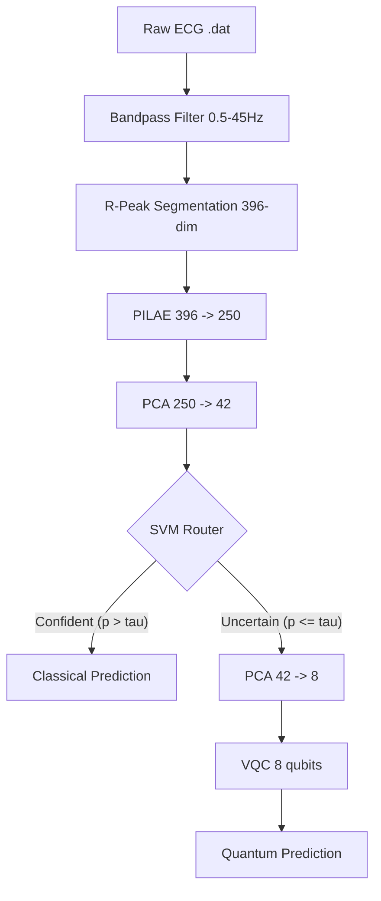

# Hybrid PILAE + VQC Arrhythmia Classification

  

A hybrid classical-quantum pipeline for cardiac arrhythmia detection from ECG signals. Uses a non-iterative Pseudoinverse Linear AutoEncoder (PILAE) for feature extraction and a Variational Quantum Circuit (VQC) to classify uncertain heartbeats routed by an SVM confidence threshold.

**Dataset:** MIT-BIH Arrhythmia Database (101,603 beats, 45 patient records)
**Tasks:** 5-class AAMI (N/S/V/F/Q) and binary (Normal vs. Abnormal)
**Evaluation:** Inter-patient De Chazal protocol (no patient data leakage)

---

## ⚡ The PILAE Advantage
Unlike traditional deep autoencoders that rely on slow, iterative gradient-descent (backpropagation), this pipeline leverages a **Pseudoinverse Linear AutoEncoder (PILAE)**. 
- **Mathematically Instant:** Computes optimal decoder weights analytically in a single closed-form matrix operation.
- **Lightning Fast:** Reduces 396-dimensional ECG vectors while retaining ~97.6% of signal data in just ~2 seconds of training time.
- **Stable & Optimal:** Eliminates vanishing gradients, local minima, and complex hyperparameter tuning (no learning rates, epochs, or batch sizes to manage).

---

## Pipeline



---

## Results

| Model | Task | Accuracy | Macro-F1 | MCC |
|:---|:---:|:---:|:---:|:---:|
| Linear SVM | 5-class | 81.89% | 0.295 | 0.336 |
| Random Forest | 5-class | 82.91% | 0.275 | 0.243 |
| Hybrid RBF SVM + VQC | 5-class | 66.12% | 0.234 | 0.289 |
| Linear SVM | Binary | 83.14% | 0.717 | 0.454 |
| Random Forest | Binary | 84.57% | 0.649 | 0.303 |
| **Hybrid LR + VQC** | **Binary** | **78.99%** | **0.692** | **0.447** |

The hybrid binary model achieves the **highest Balanced Accuracy (79.04%)** across all models, with the most symmetric error distribution between Normal and Abnormal classes.

See [REPORT.md](REPORT.md) for full analysis, per-class metrics, confusion matrices, and feature-space separability study.

---

## Project Structure

```
.
├── data/
│   ├── raw/
│   │   └── mit-bih-arrhythmia-database-1.0.0/ # Raw .dat / .hea / .atr files
│   ├── processed/                             # Processed numpy matrices (multi & binary)
│   └── extracted_features/                    # 42-dim PILAE + PCA features
├── docs/
│   ├── paper/                                 # LaTeX source + figures
│   ├── plots/                                 # Evaluation plots & confusion matrices
│   └── REPORT.md                              # Detailed project report
├── logs/                                      # Centralized execution logs
├── models/
│   ├── classical/                             # Serialized classifiers (.pkl)
│   └── vqc/                                   # VQC checkpoints (.pt)
├── src/
│   └── backend/
│       ├── preprocessing/
│       │   ├── config.py                      # Paths, filter params, AAMI mapping, splits
│       │   ├── main.py                        # Preprocessing entry point
│       │   └── ...                            # Various prep modules
│       ├── pilae/
│       │   ├── feature_pipeline.py            # PILAE + PCA entry point
│       │   └── ...                            # Autoencoder and PCA models
│       └── classification/
│           ├── train_classical.py             # 6-model benchmark entry point
│           ├── train_hybrid.py                # Hybrid routing entry point
│           └── ...                            # VQC models and feature analysis
├── tests/
│   └── test_qnn.py                            # Unit tests
├── requirements.txt
└── README.md
```

---

## Setup

**Requirements:** Python 3.8+, CUDA GPU (recommended)

```bash
pip install -r requirements.txt
```

Download the [MIT-BIH Arrhythmia Database](https://physionet.org/content/mitdb/1.0.0/) into `data/mit-bih-arrhythmia-database-1.0.0/`.

---

## Reproducing Results

Run each step sequentially:

```bash
# 1. Preprocess (5-class)
python src/backend/preprocessing/main.py --augmentation class_weight --task multi

# 2. Preprocess (binary)
python src/backend/preprocessing/main.py --augmentation class_weight --task binary

# 3. PILAE + PCA feature extraction
python src/backend/pilae/feature_pipeline.py --task multi
python src/backend/pilae/feature_pipeline.py --task binary

# 4. Classical baselines
python src/backend/classification/classical/train_classical.py --task multi
python src/backend/classification/classical/train_classical.py --task binary

# 5. Hybrid SVM + VQC
python src/backend/classification/vqc/train_hybrid.py --router rbf_svm --tau 0.80 --task multi
python src/backend/classification/vqc/train_hybrid.py --router logistic_regression --tau 0.75 --task binary

# 6. Feature-space analysis (optional)
python src/backend/classification/feature_analysis.py
```

Logs are centralized in the top-level `logs/` directory. Trained models are saved under `models/` and all plots/figures are output to `docs/plots/`.