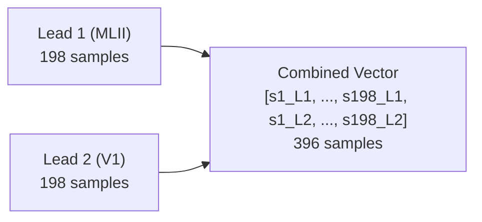
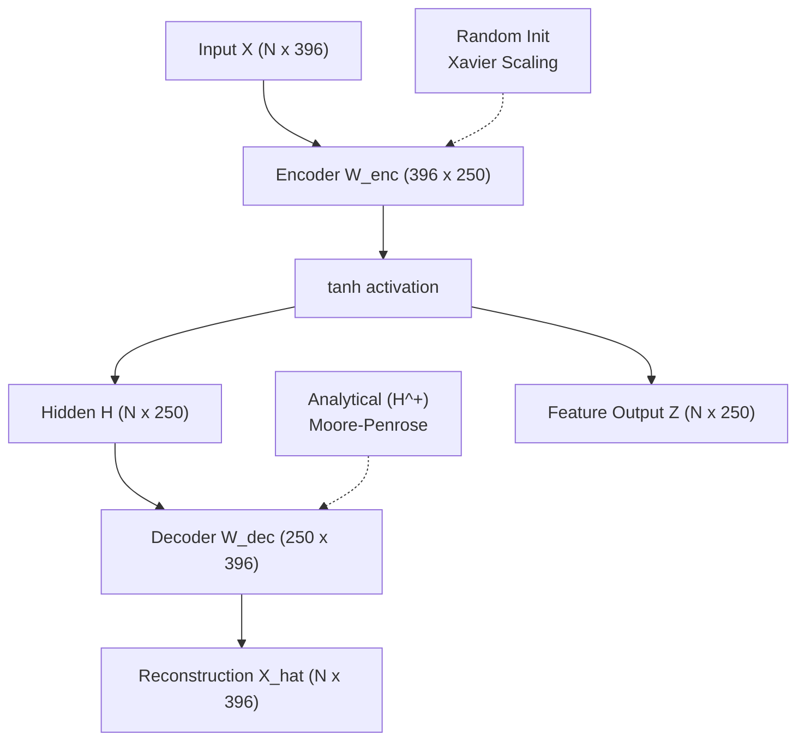
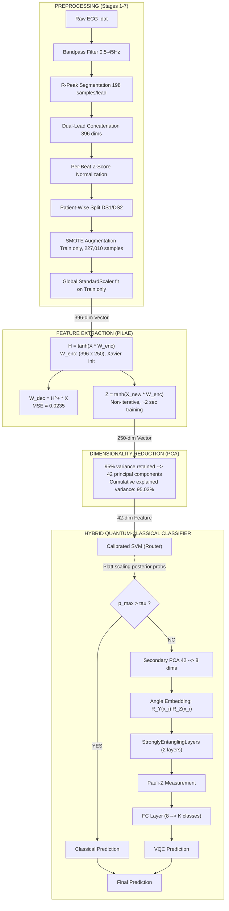
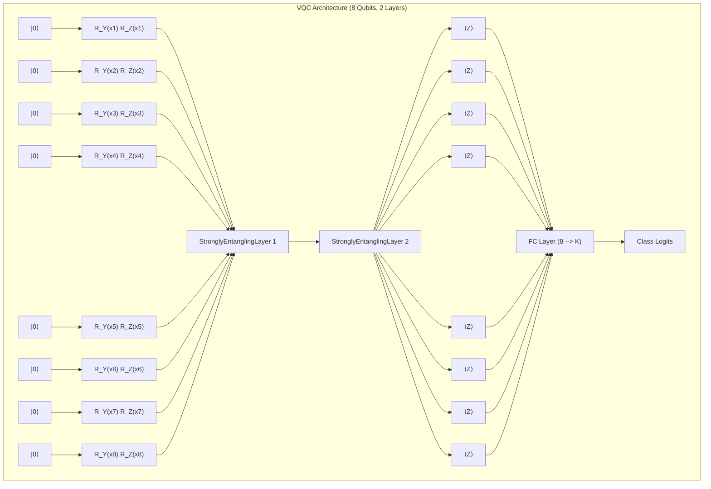

# Project Report: Hybrid PILAE and Variational Quantum Circuit Classification for Cardiac Arrhythmia Detection

## Abstract

This report presents the complete implementation and evaluation of a hybrid machine learning framework for automated cardiac arrhythmia detection from electrocardiogram (ECG) signals. The system addresses three fundamental challenges in medical signal classification: high-dimensional input features, severe class imbalance, and the need for robust inter-patient generalization. The proposed architecture replaces iterative gradient-descent feature extraction with a Pseudoinverse Linear AutoEncoder (PILAE) that computes optimal weights in closed form, achieving 97.6% signal retention with a reconstruction MSE of 0.0235. A calibrated Support Vector Machine routes confident predictions directly while delegating uncertain samples to a Variational Quantum Circuit (VQC) implemented on 8 qubits with Strongly Entangling Layers. Under the rigorous inter-patient De Chazal evaluation protocol, the system is benchmarked with six classical classifiers and multiple hybrid configurations across both five-class AAMI and binary (Normal vs. Abnormal) classification tasks. On the binary task, the hybrid Logistic Regression + VQC system achieves the highest Balanced Accuracy of 79.04% with a Macro-F1 of 0.6923, demonstrating improved minority-class detection compared to standalone classical models.

---

## Table of Contents

- [1. Introduction](#1-introduction)
- [2. Problem Statement](#2-problem-statement)
- [3. Objective](#3-objective)
- [4. Data Acquisition and Characteristics](#4-data-acquisition-and-characteristics)
  - [4.1 Dataset Source](#41-dataset-source)
  - [4.2 File Structure and Formats](#42-file-structure-and-formats)
  - [4.3 AAMI EC57 Class Mapping](#43-aami-ec57-class-mapping)
  - [4.4 Class Distribution and Imbalance Analysis](#44-class-distribution-and-imbalance-analysis)
- [5. Preprocessing Pipeline](#5-preprocessing-pipeline)
  - [5.1 Bandpass Filtering](#51-bandpass-filtering)
  - [5.2 R-Peak Extraction and Beat Segmentation](#52-r-peak-extraction-and-beat-segmentation)
  - [5.3 Dual-Lead Concatenation](#53-dual-lead-concatenation)
  - [5.4 Per-Beat Z-Score Normalization](#54-per-beat-z-score-normalization)
  - [5.5 Inter-Patient Stratified Split (De Chazal Protocol)](#55-inter-patient-stratified-split-de-chazal-protocol)
  - [5.6 SMOTE Data Augmentation](#56-smote-data-augmentation)
  - [5.7 Global Standard Scaling](#57-global-standard-scaling)
- [6. Feature Extraction: Pseudoinverse Linear AutoEncoder (PILAE)](#6-feature-extraction-pseudoinverse-linear-autoencoder-pilae)
  - [6.1 Motivation: Classical Autoencoder Limitations](#61-motivation-classical-autoencoder-limitations)
  - [6.2 PILAE Mathematical Formulation](#62-pilae-mathematical-formulation)
  - [6.3 PILAE Architecture Diagram](#63-pilae-architecture-diagram)
  - [6.4 Reconstruction Quality Assessment](#64-reconstruction-quality-assessment)
- [7. Dimensionality Reduction: PCA](#7-dimensionality-reduction-pca)
  - [7.1 Rationale and Configuration](#71-rationale-and-configuration)
  - [7.2 Compression Summary](#72-compression-summary)
- [8. System Architecture](#8-system-architecture)
- [9. Classical Classification and Benchmarking](#9-classical-classification-and-benchmarking)
  - [9.1 Model Descriptions](#91-model-descriptions)
  - [9.2 Evaluation Metrics](#92-evaluation-metrics)
  - [9.3 Five-Class AAMI Results](#93-five-class-aami-results)
  - [9.4 Binary Classification Results](#94-binary-classification-results)
  - [9.5 Classical Models: Confusion Matrix Analysis](#95-classical-models-confusion-matrix-analysis)
- [10. Hybrid Quantum Classification](#10-hybrid-quantum-classification)
  - [10.1 Routing Mechanism](#101-routing-mechanism)
  - [10.2 VQC Architecture and Quantum Feature Encoding](#102-vqc-architecture-and-quantum-feature-encoding)
  - [10.3 VQC Training Details](#103-vqc-training-details)
  - [10.4 Hybrid Router Combinations Evaluated](#104-hybrid-router-combinations-evaluated)
  - [10.5 Five-Class Hybrid Results](#105-five-class-hybrid-results)
  - [10.6 Binary Hybrid Results](#106-binary-hybrid-results)
  - [10.7 Hybrid Confusion Matrix Analysis](#107-hybrid-confusion-matrix-analysis)
- [11. Feature Space Analysis](#11-feature-space-analysis)
  - [11.1 Fisher Discriminant Ratio Analysis](#111-fisher-discriminant-ratio-analysis)
  - [11.2 Inter-Class Centroid Distance Matrix](#112-inter-class-centroid-distance-matrix)
  - [11.3 t-SNE Visualization](#113-t-sne-visualization)
- [12. Consolidated Results and Discussion](#12-consolidated-results-and-discussion)
  - [12.1 Complete Results Summary](#121-complete-results-summary)
  - [12.2 Impact of Inter-Patient Evaluation](#122-impact-of-inter-patient-evaluation)
  - [12.3 Class Imbalance as the Dominant Challenge](#123-class-imbalance-as-the-dominant-challenge)
  - [12.4 Binary vs. Multi-Class Performance](#124-binary-vs-multi-class-performance)
  - [12.5 Effectiveness of Quantum Routing](#125-effectiveness-of-quantum-routing)
  - [12.6 PILAE Efficiency](#126-pilae-efficiency)
- [13. Conclusion](#13-conclusion)
- [14. Future Work](#14-future-work)
- [15. References](#15-references)

---

## 1. Introduction

Cardiac arrhythmias -- irregular heart rhythms arising from abnormal electrical conduction -- are a leading cause of cardiovascular morbidity and sudden cardiac death worldwide. Early and accurate detection of arrhythmic events in electrocardiogram (ECG) recordings is a central problem in clinical cardiology and biomedical signal processing. The standard ambulatory Holter ECG captures the heart's electrical activity over extended periods, generating vast quantities of data that are impractical for manual annotation by cardiologists. Automated beat-level classification systems are essential for supporting clinical workflows, enabling real-time monitoring, and improving diagnostic throughput.

The MIT-BIH Arrhythmia Database has served as the de facto benchmark for evaluating such systems. It contains 48 half-hour two-lead ECG recordings annotated by expert cardiologists, with each beat categorized according to the AAMI EC57 standard into five superclasses: Normal (N), Supraventricular (S), Ventricular (V), Fusion (F), and Unknown/Paced (Q).

This project presents a complete, end-to-end hybrid machine learning pipeline that addresses the key challenges in ECG arrhythmia classification through four contributions:

1. A robust preprocessing pipeline that transforms raw ECG recordings into compact 42-dimensional morphological vectors using PILAE and PCA, with all fitting performed strictly on training data.

2. Rigorous evaluation under the inter-patient De Chazal protocol with a three-way split (train/validation/test), ensuring no patient's beats appear in more than one partition.

3. A hybrid classical-quantum classification architecture where a calibrated SVM routes uncertain samples to a Variational Quantum Circuit for enhanced non-linear decision-making.

4. Comprehensive benchmarking of six classical models and multiple hybrid configurations on both five-class AAMI and binary classification tasks, accompanied by feature-space separability analysis.

---

## 2. Problem Statement

ECG data analysis is fundamentally challenging due to three interrelated factors:

**High Dimensionality.** Each heartbeat, when captured across two leads at 360 Hz, generates a 396-dimensional feature vector. This high dimensionality introduces computational overhead and increases the risk of overfitting, particularly with limited minority-class samples.

**Severe Class Imbalance.** Normal beats constitute approximately 87.9% of all samples. Classical ML models inherently suffer from "accuracy inflation," achieving deceptively high overall accuracy by aggressively biasing toward the majority class while disastrously failing to detect minority, life-threatening arrhythmias.

**Inter-Patient Variability.** Most published ECG classification results employ intra-patient evaluation protocols, where beats from the same patient appear in both training and test sets. These models memorize patient-specific signal characteristics (resting heart rate, electrode impedance, body habitus) rather than learning generalizable arrhythmia morphologies. The inter-patient evaluation protocol used in this work prevents such information leakage, yielding substantially lower but more realistic performance estimates.

**Feature Extraction Bottleneck.** Traditional deep neural autoencoders used for dimensionality reduction rely on slow, iterative gradient-descent optimization (backpropagation) that is prone to vanishing gradients, local minima, and requires extensive hyperparameter tuning across learning rate, batch size, epoch count, and optimizer selection.

---

## 3. Objective

To engineer an industry-grade hybrid machine learning pipeline that prioritizes medical diagnostic sensitivity (Recall) and balanced performance metrics over deceptive baseline accuracy. The specific objectives are:

1. Replace gradient-descent feature extraction with a mathematically instantaneous Pseudoinverse Linear AutoEncoder (PILAE).
2. Enforce the inter-patient De Chazal split protocol to prevent data leakage and provide realistic generalization estimates.
3. Apply SMOTE augmentation with adaptive k-neighbors to force the model to learn rare arrhythmia morphologies.
4. Implement a confidence-based hybrid classical-quantum routing architecture that delegates uncertain samples to a GPU-accelerated Variational Quantum Circuit.
5. Benchmark the complete system across both five-class AAMI and binary classification tasks with comprehensive evaluation metrics.

---

## 4. Data Acquisition and Characteristics

### 4.1 Dataset Source

The project utilizes the **MIT-BIH Arrhythmia Database**, hosted on PhysioNet. The database contains 48 half-hour ambulatory ECG recordings from 47 patients, digitized at 360 Hz with 11-bit resolution over a 10 mV range. Each recording contains approximately 2,000 annotated heartbeats, totaling over 109,000 beats across the database. Annotations were independently verified by at least two cardiologists.

### 4.2 File Structure and Formats

Each patient record consists of three files:

- **`.dat` (Waveform Data):** Raw, continuous physiological waveforms stored in binary format. Each file contains approximately 650,000 samples representing ~30 minutes of continuous two-lead ECG recording.

- **`.hea` (Header Metadata):** Contains recording metadata including sampling frequency (360 Hz), number of channels, signal gain, baseline voltage, channel names (e.g., MLII, V1), and record duration.

- **`.atr` (Annotation Data):** Contains expert cardiologist annotations that map the exact sample indices of R-peaks to their corresponding beat classification symbols. These annotations serve as ground truth labels for supervised learning.

### 4.3 AAMI EC57 Class Mapping

Following the AAMI EC57 standard, the 15 fine-grained MIT-BIH annotation symbols are mapped into five standardized superclasses:

| AAMI Class | Integer Label | Raw MIT-BIH Symbols | Clinical Description |
|:---|:---:|:---|:---|
| Normal (N) | 0 | N (Normal beat), L (Left BBB), R (Right BBB), e (Atrial escape), j (Junctional escape) | Normal sinus rhythm and conduction variants |
| Supraventricular (S) | 1 | A (Atrial premature), a (Aberrated atrial premature), J (Junctional premature), S (Supraventricular ectopic) | Premature beats originating above the ventricles |
| Ventricular (V) | 2 | V (Premature ventricular contraction), E (Ventricular escape) | Clinically dangerous premature beats from the ventricles |
| Fusion (F) | 3 | F (Fusion of ventricular and normal beat) | Simultaneous activation from sinus and ventricular foci |
| Unknown (Q) | 4 | / (Paced beat), f (Fusion of paced and normal), Q (Unclassifiable) | Pacemaker-induced or unclassifiable beats |

### 4.4 Class Distribution and Imbalance Analysis

Under the inter-patient De Chazal split protocol, the dataset exhibits extreme imbalance:

| Split | Records | N | S | V | F | Q | Total |
|:---|:---:|---:|---:|---:|---:|---:|---:|
| Train (DS1) | 18 | 37,644 (91.7%) | 246 (0.6%) | 2,763 (6.7%) | 381 (0.9%) | 4 (0.01%) | 41,038 |
| Validation (DS1-Val) | 4 | 7,758 (83.2%) | 676 (7.2%) | 875 (9.4%) | 15 (0.2%) | 0 (0.0%) | 9,324 |
| Test (DS2) | 23 | 43,896 (85.7%) | 1,813 (3.5%) | 3,091 (6.0%) | 386 (0.8%) | 2,055 (4.0%) | 51,241 |

Key observations:
- The N class comprises **87.9%** of all beats across the entire dataset.
- The Q class has only **4 training samples** out of 41,038, rendering reliable learning effectively impossible without augmentation.
- The validation set has **zero Q-class samples**, meaning Q-class performance cannot be validated during training.
- The S class represents only **0.6%** of training data, despite being clinically significant.

---

## 5. Preprocessing Pipeline

### 5.1 Bandpass Filtering

A first-order Butterworth bandpass filter (0.5--45 Hz) is applied to each ECG lead using zero-phase forward-backward filtering via `scipy.signal.filtfilt`:

| Parameter | Value | Purpose |
|:---|:---|:---|
| Low cutoff | 0.5 Hz | Removes baseline wander from patient respiration and body movement |
| High cutoff | 45 Hz | Suppresses 50/60 Hz power-line interference and high-frequency muscle artifacts |
| Filter order | 1 | When applied bidirectionally, yields an effective order-2 zero-phase filter |
| Sampling frequency | 360 Hz | Native MIT-BIH acquisition rate |

Zero-phase filtering ensures R-peak positions are not temporally shifted, preserving the exact morphological alignment between annotation and signal.

### 5.2 R-Peak Extraction and Beat Segmentation

Using the annotated R-peak sample indices from `.atr` files, a fixed window is extracted around each R-peak:

- **Window size:** 99 samples before + 99 samples after = **198 samples per lead**
- **Duration:** 198 / 360 Hz = **550 ms**, capturing the complete P-wave, QRS complex, and T-wave

**Exclusion criteria:**
- Adjacent R-peak closer than 99 samples (prevents overlap with neighboring beats in tachycardic rhythms where heart rate exceeds ~220 BPM)
- Window extends beyond recording boundaries
- Annotation symbol not in the AAMI mapping (non-beat annotations such as rhythm changes or artifacts)
- First and last beat of each record (cannot verify adjacent R-peak distances)

### 5.3 Dual-Lead Concatenation

Segments from both ECG leads are concatenated:

This produces a **396-dimensional feature vector** per beat. The dual-lead representation is critical because certain arrhythmias manifest more prominently in one lead configuration than the other.

### 5.4 Per-Beat Z-Score Normalization

Each lead within each beat is independently normalized:

$$z = \frac{x - \mu}{\sigma}$$

Where $\mu$ and $\sigma$ are computed independently for Lead 1 (samples 1-198) and Lead 2 (samples 199-396) of each individual beat. Beats with zero standard deviation (flat-line segments) are left unchanged.

This normalization removes amplitude variability caused by:
- Differing patient body habitus (body mass, chest wall thickness)
- Electrode placement variations
- Signal gain differences between recording sessions

The model is forced to learn the morphological *shape* of each heartbeat rather than its raw voltage magnitude.

### 5.5 Inter-Patient Stratified Split (De Chazal Protocol)

The dataset is partitioned following the De Chazal inter-patient protocol, assigning entire patient records to non-overlapping sets:

**DS1-Train (18 records):** 101, 106, 108, 109, 112, 114, 115, 116, 118, 119, 122, 124, 203, 205, 208, 215, 220, 230

**DS1-Val (4 records):** 201, 207, 209, 223 -- Selected for arrhythmia class diversity (200-series records contain substantial minority arrhythmia classes)

**DS2-Test (23 records):** 100, 103, 104, 105, 111, 113, 117, 121, 123, 200, 202, 210, 212, 213, 214, 219, 221, 222, 228, 231, 232, 233, 234

This strict inter-patient partition ensures:
- No beats from the same patient appear in more than one partition
- The model cannot memorize patient-specific resting heart rate, baseline amplitude, or electrode characteristics
- Performance estimates reflect realistic generalization to unseen patients

### 5.6 SMOTE Data Augmentation

The Synthetic Minority Over-sampling Technique (SMOTE) is applied exclusively to the training set to address extreme class imbalance:

**Algorithm configuration:**
- **Target:** Equalize all classes to the majority class count (45,402 per class)
- **k-neighbors:** Dynamically computed as `max(1, min(5, min_class_size - 1))`
- **Ultra-rare handling:** Classes with fewer than 10 samples (e.g., Q with 4 samples) are first upsampled via `RandomOverSampler` (capped at 50 samples), then processed by SMOTE
- **Random state:** 42 (fixed for reproducibility)

**Augmentation results:**

| Class | Before SMOTE | After SMOTE | Synthetic Samples Generated |
|:---:|---:|---:|---:|
| N | 45,402 | 45,402 | 0 |
| S | 922 | 45,402 | 44,480 |
| V | 3,638 | 45,402 | 41,764 |
| F | 396 | 45,402 | 45,006 |
| Q | 4 | 45,402 | 45,398 |
| **Total** | **50,362** | **227,010** | **176,648** |

### 5.7 Global Standard Scaling

A `StandardScaler` is fitted exclusively on the augmented training data and applied to all three splits:

$$x_{scaled} = \frac{x - \mu_{train}}{\sigma_{train}}$$

Where $\mu_{train}$ and $\sigma_{train}$ are the column-wise mean and standard deviation computed from the training set only. This ensures:
- Zero-mean and unit-variance across all 396 dimensions
- No data leakage from validation or test sets into the scaling statistics
- The fitted scaler is serialized as `standard_scaler.pkl` for inference reproducibility

---

## 6. Feature Extraction: Pseudoinverse Linear AutoEncoder (PILAE)

### 6.1 Motivation: Classical Autoencoder Limitations

Traditional deep neural autoencoders use backpropagation to iteratively minimize a reconstruction loss. This approach has several drawbacks:

| Issue | Impact |
|:---|:---|
| **Iterative optimization** | Requires hundreds of epochs, each involving forward/backward passes over the entire dataset |
| **Vanishing gradients** | Deep networks with tanh/sigmoid activations suffer from gradient decay in early layers |
| **Local minima** | Non-convex loss landscape means gradient descent may converge to suboptimal solutions |
| **Hyperparameter sensitivity** | Performance depends on learning rate, batch size, optimizer, weight initialization, and epoch count |
| **Non-deterministic** | Stochastic gradient noise and random initialization make exact reproduction difficult |

PILAE addresses all of these by computing the optimal decoder weights analytically in a single matrix operation.

### 6.2 PILAE Mathematical Formulation

**Step 1: Encoder Initialization**

The encoder weight matrix $W_{enc} \in \mathbb{R}^{396 \times 250}$ is randomly initialized with Xavier scaling:

$$W_{enc} \sim \mathcal{N}\left(0, \frac{1}{\sqrt{396}}\right) \approx \mathcal{N}(0, 0.0503)$$

The scaling factor $1/\sqrt{d}$ constrains the variance of the dot product $X \cdot W_{enc}$, preventing the tanh activation from saturating in its flat regions (where $|x| > 3$).

**Step 2: Hidden Representation**

The encoder maps each input to a 250-dimensional hidden space using a non-linear activation:

$$H = \tanh(X \cdot W_{enc}) \in \mathbb{R}^{N \times 250}$$

The tanh function introduces non-linearity while bounding outputs to $[-1, 1]$, making the representation robust to outliers.

**Step 3: Analytical Decoder via Pseudoinverse**

Instead of iteratively optimizing decoder weights through gradient descent, PILAE computes them in closed form using the Moore-Penrose pseudoinverse:

$$W_{dec} = H^{+} \cdot X = (H^T H)^{-1} H^T \cdot X \in \mathbb{R}^{250 \times 396}$$

This directly minimizes the reconstruction error $\|X - H \cdot W_{dec}\|_F^2$ in a single operation, guaranteed to find the globally optimal least-squares solution.

**Step 4: Feature Extraction (Inference)**

For new data, only the encoder is used:

$$Z = \tanh(X_{new} \cdot W_{enc}) \in \mathbb{R}^{N_{new} \times 250}$$

The decoder weights are only needed during training to verify reconstruction fidelity.

### 6.3 PILAE Architecture Diagram

**Key Properties:**
- **Training:** Single closed-form operation (no epochs, no learning rate)
- **Activation:** tanh (non-linear, bounded [-1, 1])
- **Decoder:** Globally optimal least-squares solution
- **Random seed:** 42 (deterministic reproduction)

### 6.4 Reconstruction Quality Assessment

| Metric | Value |
|:---|:---|
| Input dimension | 396 |
| Hidden dimension (bottleneck) | 250 |
| Compression ratio (Stage 1) | 396 / 250 = 1.58x |
| Mean Squared Reconstruction Error | 0.0235 |
| Signal retention | ~97.6% |
| Training samples | 41,038 (3-way split, no SMOTE) |
| Pseudoinverse computation time | ~2 seconds |
| Total PILAE training time | ~2 seconds |

The reconstruction MSE of 0.0235 demonstrates that the 250-dimensional bottleneck faithfully preserves the essential morphological structure of the 396-dimensional ECG input without any iterative optimization.

---

## 7. Dimensionality Reduction: PCA

### 7.1 Rationale and Configuration

The 250-dimensional PILAE hidden representations contain residual structural redundancy. Principal Component Analysis (PCA) is applied to project these features onto the directions of maximum variance, eliminating correlated dimensions while preserving discriminative content.

| Configuration | Value |
|:---|:---|
| Variance retention target | 95% |
| Input dimensions | 250 |
| Output dimensions | 42 components |
| Cumulative explained variance | 95.03% |
| Data leakage prevention | PCA fitted exclusively on training data |
| Random state | 42 |

### 7.2 Compression Summary

The two-stage reduction pipeline achieves:

| Stage | Transformation | Compression |
|:---|:---|:---|
| PILAE | 396 --> 250 | 1.58x |
| PCA | 250 --> 42 | 5.95x |
| **Overall** | **396 --> 42** | **9.4x** |

Only 42 principal components are needed to capture 95.03% of the total morphological variance in the PILAE feature space. This aggressive compression is critical for two reasons:
1. It removes noise and redundancy, improving classifier generalization.
2. It enables the VQC (limited to a small number of qubits) to operate on a tractable input space after a secondary PCA to 8 dimensions.

---

## 8. System Architecture

The complete system architecture follows a sequential pipeline with a branching hybrid classification stage:

---

## 9. Classical Classification and Benchmarking

### 9.1 Model Descriptions

Six classical models are benchmarked on the 42-dimensional PILAE+PCA features:

**1. Linear SVM (Primary Pre-Classifier)**
- Implementation: `sklearn.svm.LinearSVC`
- Configuration: L2-regularized, `dual=False`, `max_iter=10000`, `class_weight='balanced'`
- Role: Primary pre-classifier; also serves as a routing candidate due to its geometric decision function

**2. RBF SVM (Calibrated)**
- Implementation: `sklearn.svm.SVC(kernel='rbf', probability=True)`
- Configuration: Platt probability calibration, `class_weight='balanced'`, `cache_size=1000`
- Role: Primary router for hybrid VQC system (provides calibrated posterior probabilities)

**3. Logistic Regression**
- Implementation: `sklearn.linear_model.LogisticRegression`
- Configuration: Multinomial, `max_iter=1000`, `class_weight='balanced'`
- Role: Linear baseline; also used as a router in binary hybrid experiments

**4. Decision Tree**
- Implementation: `sklearn.tree.DecisionTreeClassifier`
- Configuration: CART algorithm, `class_weight='balanced'`
- Role: Non-linear baseline

**5. Random Forest**
- Implementation: `sklearn.ensemble.RandomForestClassifier`
- Configuration: 200 estimators, `n_jobs=-1`, `class_weight='balanced'`
- Role: Ensemble baseline

**6. XGBoost**
- Implementation: `xgboost.XGBClassifier`
- Configuration: Gradient-boosted trees, `n_jobs=-1`, sample-weighted loss using computed class weights
- Role: Gradient boosting baseline

### 9.2 Evaluation Metrics

Given the severe class imbalance, multiple metrics are reported:

**Overall Accuracy:** $\frac{\text{Correct Predictions}}{\text{Total Predictions}}$ -- The most basic metric; heavily inflated by the majority class in imbalanced settings.

**Balanced Accuracy:** $\frac{1}{C} \sum_{c=1}^{C} \text{Recall}_c$ -- Average per-class recall, giving equal weight to all classes regardless of support. A model that predicts only the majority class scores 1/C.

**Macro-F1:** $\frac{1}{C} \sum_{c=1}^{C} F1_c$ where $F1_c = \frac{2 \cdot P_c \cdot R_c}{P_c + R_c}$ -- Unweighted mean of per-class F1 scores. The primary metric for imbalanced evaluation because it equally penalizes poor performance on any class.

**Weighted-F1:** $\sum_{c=1}^{C} w_c \cdot F1_c$ where $w_c = \frac{|c|}{\sum |c|}$ -- Support-weighted mean of per-class F1 scores; accounts for class frequency.

**Matthews Correlation Coefficient (MCC):** A balanced measure ranging from -1 (total disagreement) to +1 (perfect prediction) that accounts for all four confusion matrix quadrants (TP, TN, FP, FN). It is informative even when classes are very imbalanced.

**Precision:** $\frac{TP}{TP + FP}$ -- Of all samples predicted as class $c$, what fraction actually belongs to class $c$?

**Recall (Sensitivity):** $\frac{TP}{TP + FN}$ -- Of all actual class $c$ samples, what fraction was correctly detected? Critical in medical diagnostics where missing a positive case (arrhythmia) has severe consequences.

### 9.3 Five-Class AAMI Results

**Test Set Performance (DS2, 51,241 beats):**

| Model | Accuracy | Balanced Acc | Macro-F1 | Weighted-F1 | MCC | Train Time |
|:---|:---:|:---:|:---:|:---:|:---:|:---:|
| **Linear SVM** | 81.89% | 36.20% | **0.2950** | 0.8147 | **0.3358** | 1.2s |
| **RBF SVM** | 68.64% | 44.80% | 0.2719 | 0.7379 | 0.3262 | 48.6s |
| **Logistic Regression** | 49.19% | 31.26% | 0.2312 | 0.5967 | 0.1294 | 11.0s |
| **Decision Tree** | 68.06% | 31.78% | 0.2481 | 0.7168 | 0.1637 | 3.0s |
| **Random Forest** | **82.91%** | 29.26% | 0.2750 | 0.8031 | 0.2432 | 6.0s |
| **XGBoost** | 70.22% | 35.35% | 0.2489 | 0.7334 | 0.2245 | 4.8s |

**Per-Class Performance (Linear SVM -- Best Macro-F1):**

| Class | Precision | Recall | F1-Score | Support |
|:---:|:---:|:---:|:---:|---:|
| N | 0.924 | 0.909 | 0.917 | 43,896 |
| S | 0.016 | 0.006 | 0.008 | 1,813 |
| V | 0.381 | 0.626 | 0.474 | 3,091 |
| F | 0.045 | 0.269 | 0.077 | 386 |
| Q | 0.000 | 0.000 | 0.000 | 2,055 |

**Per-Class Performance (RBF SVM -- Highest Balanced Accuracy):**

| Class | Precision | Recall | F1-Score | Support |
|:---:|:---:|:---:|:---:|---:|
| N | 0.972 | 0.729 | 0.833 | 43,896 |
| S | 0.122 | 0.067 | 0.086 | 1,813 |
| V | 0.208 | 0.924 | 0.339 | 3,091 |
| F | 0.056 | 0.521 | 0.101 | 386 |
| Q | 0.000 | 0.000 | 0.000 | 2,055 |

### 9.4 Binary Classification Results

For the binary task, all non-Normal beats are merged into a single "Abnormal" (A) class.

**Test Set Performance:**

| Model | Accuracy | Balanced Acc | Macro-F1 | Weighted-F1 | MCC | Train Time |
|:---|:---:|:---:|:---:|:---:|:---:|:---:|
| **Linear SVM** | 83.14% | **76.85%** | **0.7167** | 0.8453 | **0.4541** | 0.3s |
| **Logistic Regression** | 82.37% | 76.62% | 0.7094 | 0.8394 | 0.4436 | 1.3s |
| **Random Forest** | **84.57%** | 63.39% | 0.6485 | 0.8363 | 0.3030 | 8.3s |
| **Decision Tree** | 74.79% | 64.57% | 0.6032 | 0.7741 | 0.2350 | 5.5s |
| **XGBoost** | 71.07% | 67.24% | 0.5957 | 0.7495 | 0.2583 | 2.5s |
| **RBF SVM** | 64.56% | 70.24% | 0.5690 | 0.6986 | 0.2861 | 23.1s |

**Per-Class Performance (Linear SVM -- Best Macro-F1):**

| Class | Precision | Recall | F1-Score | Support |
|:---:|:---:|:---:|:---:|---:|
| N | 0.941 | 0.857 | 0.897 | 43,896 |
| A | 0.443 | 0.680 | 0.536 | 7,345 |

### 9.5 Classical Models: Confusion Matrix Analysis

**Five-Class Confusion Matrices:**

| Linear SVM | RBF SVM |
|:---:|:---:|
|  |  |

| Random Forest | XGBoost |
|:---:|:---:|
|  |  |

**Dominant Error Transitions (Linear SVM, Five-Class):**
- S --> N: 1,704 / 1,813 (94.0%) -- Supraventricular beats nearly indistinguishable from Normal
- Q --> V: 1,631 / 2,055 (79.4%) -- Unknown/paced beats absorbed into Ventricular class
- F --> N: 263 / 386 (68.1%) -- Fusion beats collapsed into Normal class
- V --> N: 947 / 3,091 (30.6%) -- Nearly a third of Ventricular beats misclassified as Normal

**Binary Classification Confusion Matrices:**

| Linear SVM (Binary) | Logistic Regression (Binary) | Random Forest (Binary) |
|:---:|:---:|:---:|
|  |  |  |

---

## 10. Hybrid Quantum Classification

### 10.1 Routing Mechanism

The calibrated RBF SVM produces posterior probabilities $p(c|z)$ for each class via Platt scaling. The maximum posterior probability $p_{max} = \max_c p(c|z)$ serves as a confidence score. A threshold $\tau$ partitions the input space:

$$\hat{y} = \begin{cases} \text{SVM}(z), & \text{if } p_{max}(z) > \tau \\ \text{VQC}(z), & \text{otherwise} \end{cases}$$

This routing mechanism enables:
- **Efficient processing:** The majority of samples are handled by the fast classical classifier.
- **Focused quantum resources:** Only uncertain, boundary-overlapping samples are sent to the computationally expensive VQC.
- **Tunable sensitivity:** Adjusting $\tau$ controls the trade-off between classical throughput and quantum scrutiny.

**Routing Statistics (Various Configurations):**

| Router | Task | tau | Train Classical | Train VQC | Val Classical | Val VQC |
|:---|:---:|:---:|---:|---:|---:|---:|
| RBF SVM | 5-class | 0.80 | 40,905 (99.7%) | 133 (0.3%) | 7,923 (85.0%) | 1,401 (15.0%) |
| LR | Binary | 0.75 | 34,541 (84.2%) | 6,497 (15.8%) | 7,106 (76.2%) | 2,218 (23.8%) |

### 10.2 VQC Architecture and Quantum Feature Encoding

**Secondary PCA Compression:** The 42-dimensional features are compressed to **8 dimensions** via a secondary PCA fitted on the VQC training subset (ambiguous samples only). This reduction matches the qubit count of the quantum circuit.

**Dual-Axis Angle Embedding:** Each of the 8 features is encoded into a qubit using two rotation gates:

$$|\psi(x)\rangle = \prod_{i=1}^{8} R_Y(x_i) \cdot R_Z(x_i) |0\rangle^{\otimes 8}$$

Features are scaled to $[0, \pi]$ per-batch using min-max normalization for optimal rotation gate coverage.

**Strongly Entangling Layers:** The encoded state passes through 2 layers of parameterized quantum gates:

$$U(\theta) = \prod_{l=1}^{2} \text{StronglyEntanglingLayer}(\theta_l)$$

Each layer consists of:
- Single-qubit rotations: $R(\theta_1, \theta_2, \theta_3)$ per qubit (3 trainable parameters each)
- CNOT entanglement gates between qubit pairs (creates multi-qubit correlations)
- Total trainable quantum parameters: $2 \times 8 \times 3 = 48$

**Pauli-Z Measurement:** Expectation values of the Pauli-Z operator are measured on each qubit:

$$o_i = \langle \psi(x, \theta) | Z_i | \psi(x, \theta) \rangle \in [-1, 1], \quad i = 1, \ldots, 8$$

**Classical Post-Processing:** A fully-connected linear layer maps the 8 measurement outcomes to $K$ class logits:

$$\text{logits} = W_{fc} \cdot [o_1, ..., o_8]^T + b$$

### 10.3 VQC Training Details

| Parameter | Value |
|:---|:---|
| Qubits | 8 |
| Entangling Layers | 2 (StronglyEntanglingLayers) |
| Quantum Parameters | 48 |
| Classical Parameters | 8 x K + K (FC layer) |
| Maximum Epochs | 100 |
| Batch Size | 32 |
| Loss Function | Class-weighted cross-entropy |
| Optimizer | Adam |
| Initial Learning Rate | 0.01 |
| LR Schedule | Cosine annealing (min LR = 1e-4) |
| Early Stopping | Patience = 15 epochs (based on validation loss) |
| Backend | PennyLane `lightning.gpu` (fallback: `default.qubit`) |
| Compute Device | NVIDIA GPU (CUDA) |

### 10.4 Hybrid Router Combinations Evaluated

The following hybrid configurations were trained and evaluated:

| Experiment | Router Model | Task | tau | Strategy |
|:---|:---|:---:|:---:|:---|
| 1 | Logistic Regression | 5-class | 0.70 | Probability (p_max) |
| 2 | Random Forest | 5-class | 0.90 | Probability (p_max) |
| 3 | RBF SVM (Calibrated) | 5-class | 0.80 | Probability (p_max) |
| 4 | Linear SVM | 5-class | N/A | Decision function |
| 5 | Logistic Regression | Binary | 0.75 | Probability (p_max) |

### 10.5 Five-Class Hybrid Results

**Hybrid RBF SVM + VQC (tau=0.80):**

| Metric | Value |
|:---|:---|
| Overall Accuracy | 66.12% |
| Balanced Accuracy | 34.39% |
| Macro-F1 | 0.2338 |
| MCC | 0.2893 |
| Classical-only Accuracy | 68.64% |
| VQC Accuracy (routed) | 5.92% |
| Test Routing: Classical | 40,768 (79.6%) |
| Test Routing: VQC | 10,473 (20.4%) |
| VQC Training Time | 594s (~10 min) |

**Hybrid Logistic Regression + VQC (tau=0.70):**

| Metric | Value |
|:---|:---|
| Overall Accuracy | 56.72% |
| Macro-F1 | 0.2471 |
| Test Routing: VQC | 21,786 (42.5%) |

**Hybrid Random Forest + VQC (tau=0.90):**

| Metric | Value |
|:---|:---|
| Overall Accuracy | 86.37% |
| Macro-F1 | 0.2273 |
| Test Routing: VQC | 50,368 (98.3%) |

### 10.6 Binary Hybrid Results

**Hybrid Logistic Regression + VQC (tau=0.75):**

| Metric | Value |
|:---|:---|
| Overall Accuracy | 78.99% |
| Balanced Accuracy | **79.04%** |
| Macro-F1 | 0.6923 |
| Weighted-F1 | 0.8159 |
| MCC | 0.4469 |
| Classical-only Accuracy | 82.37% |
| VQC Accuracy (routed) | 61.32% |
| Test Routing: Classical | 31,835 (62.1%) |
| Test Routing: VQC | 19,406 (37.9%) |
| VQC Training Time | 12,374s (~3.4 hours) |
| Inference Time | 403s |
| VQC Epochs | 33 (early stopped at best val loss 0.7069) |

**Per-Class Performance:**

| Class | Precision | Recall | F1-Score | Support |
|:---:|:---:|:---:|:---:|---:|
| N (Normal) | 0.958 | 0.790 | 0.866 | 43,896 |
| A (Abnormal) | 0.386 | 0.791 | 0.519 | 7,345 |

**Error Transitions:**
- N --> A: 9,233 / 43,896 (21.0%)
- A --> N: 1,534 / 7,345 (20.9%)

The nearly symmetric error pattern (21.0% vs 20.9%) indicates the hybrid model achieves balanced sensitivity between Normal and Abnormal classes, unlike classical models that heavily favor the majority class.

### 10.7 Hybrid Confusion Matrix Analysis

**Hybrid RBF SVM + VQC (5-class, tau=0.80):**

**Hybrid Logistic Regression + VQC (Binary, tau=0.75):**

---

## 11. Feature Space Analysis

### 11.1 Fisher Discriminant Ratio Analysis

The Fisher Linear Discriminant Ratio (FDR) measures the mean squared separation between two class centroids relative to their combined within-class variance:

$$\text{FDR}(c_1, c_2) = \frac{1}{d} \sum_{j=1}^{d} \frac{(\mu_{c_1,j} - \mu_{c_2,j})^2}{\sigma_{c_1,j}^2 + \sigma_{c_2,j}^2}$$

| Class Pair | FDR | Interpretation |
|:---|:---:|:---|
| N -- S | 0.0534 | Extremely low -- near-complete morphological overlap |
| S -- V | 0.1025 | Low -- substantial overlap |
| N -- F | 0.2046 | Moderate -- partially distinguishable |
| V -- F | 0.2066 | Moderate -- partially distinguishable |
| V -- Q | 0.1993 | Moderate -- partially distinguishable |

The extremely low FDR between N and S (0.0534) directly explains why over 94% of S beats are misclassified as N: supraventricular ectopic beats share nearly identical morphology with normal beats in the PILAE+PCA feature space. The moderate FDR values for V--F and V--Q pairs align with the observed confusion matrix patterns.

### 11.2 Inter-Class Centroid Distance Matrix

Euclidean distances between class centroids in the 42-dimensional PILAE+PCA feature space:

|   | N | S | V | F | Q |
|:---:|:---:|:---:|:---:|:---:|:---:|
| **N** | 0.00 | 2.85 | 3.57 | 5.97 | 4.60 |
| **S** | 2.85 | 0.00 | 4.49 | 7.62 | 4.00 |
| **V** | 3.57 | 4.49 | 0.00 | 5.18 | 5.11 |
| **F** | 5.97 | 7.62 | 5.18 | 0.00 | 7.68 |
| **Q** | 4.60 | 4.00 | 5.11 | 7.68 | 0.00 |

Key observations:
- **N--S distance (2.85)** is the smallest among all pairs, confirming extreme morphological similarity.
- **F class** is the most geometrically isolated (distances 5.18--7.68 to other classes), yet classification is poor due to its tiny sample size (381 training, 386 test).
- **Q--S distance (4.00)** is relatively small, explaining Q-to-V misclassification given Q's proximity to the S-V region.

### 11.3 t-SNE Visualization

A two-dimensional t-SNE projection of the 42-dimensional feature space provides visual confirmation:

The plot reveals:
- The **massive N class density** completely engulfs the S instances, graphically reflecting the extremely low FDR metric.
- The **V class** forms a partially distinguishable cluster on the periphery, enabling moderate classification success (F1 = 0.474 with Linear SVM).
- The **F and Q classes** are sparsely scattered and heavily overlapping with other classes.

---

## 12. Consolidated Results and Discussion

### 12.1 Complete Results Summary

**Five-Class AAMI Classification (Test Set -- DS2):**

| Rank | Model | Accuracy | Balanced Acc | Macro-F1 | MCC |
|:---:|:---|:---:|:---:|:---:|:---:|
| 1 | Random Forest | **82.91%** | 29.26% | 0.2750 | 0.2432 |
| 2 | Linear SVM | 81.89% | 36.20% | **0.2950** | **0.3358** |
| 3 | XGBoost | 70.22% | 35.35% | 0.2489 | 0.2245 |
| 4 | RBF SVM | 68.64% | **44.80%** | 0.2719 | 0.3262 |
| 5 | Decision Tree | 68.06% | 31.78% | 0.2481 | 0.1637 |
| 6 | Hybrid RBF SVM + VQC | 66.12% | 34.39% | 0.2338 | 0.2893 |
| 7 | Logistic Regression | 49.19% | 31.26% | 0.2312 | 0.1294 |

**Binary Classification (Test Set -- DS2):**

| Rank | Model | Accuracy | Balanced Acc | Macro-F1 | MCC |
|:---:|:---|:---:|:---:|:---:|:---:|
| 1 | Random Forest | **84.57%** | 63.39% | 0.6485 | 0.3030 |
| 2 | Linear SVM | 83.14% | 76.85% | **0.7167** | **0.4541** |
| 3 | Logistic Regression | 82.37% | 76.62% | 0.7094 | 0.4436 |
| 4 | Hybrid LR + VQC (tau=0.75) | 78.99% | **79.04%** | 0.6923 | 0.4469 |
| 5 | Decision Tree | 74.79% | 64.57% | 0.6032 | 0.2350 |
| 6 | XGBoost | 71.07% | 67.24% | 0.5957 | 0.2583 |
| 7 | RBF SVM | 64.56% | 70.24% | 0.5690 | 0.2861 |

### 12.2 Impact of Inter-Patient Evaluation

The five-class results (best Macro-F1 = 0.295) are substantially lower than studies using intra-patient splits, which routinely report Macro-F1 > 0.90. This discrepancy underscores the well-documented gap between intra-patient and inter-patient evaluation. Models that learn patient-specific signal characteristics (resting heart rate, QRS amplitude, baseline offset) inflate their apparent performance when beats from the same patient appear in both training and test sets.

Our results, while lower in absolute terms, provide a more realistic estimate of how the system would perform on genuinely unseen patients -- the clinically relevant scenario.

### 12.3 Class Imbalance as the Dominant Challenge

The Fisher discriminant analysis demonstrates that poor minority-class performance is driven by two factors:

1. **Morphological similarity:** The FDR between N and S (0.0534) indicates that supraventricular ectopic beats share nearly identical morphology with normal beats in the PILAE feature space. No classifier can reliably separate classes that are geometrically overlapping.

2. **Extreme training set underrepresentation:** S has only 246 training samples (0.6%), F has 381 (0.9%), and Q has only 4 (0.01%). Despite SMOTE augmentation to 45,402 per class, the synthetic samples are interpolations of the original few samples and cannot introduce genuinely new morphological patterns.

### 12.4 Binary vs. Multi-Class Performance

The binary formulation dramatically improves minority-class metrics:

| Metric | Five-Class (Linear SVM) | Binary (Linear SVM) |
|:---|:---:|:---:|
| Macro-F1 | 0.2950 | 0.7167 |
| MCC | 0.3358 | 0.4541 |
| Minority Recall | 0.6% (S), 0.0% (Q) | 68.0% (Abnormal) |

This confirms that the problem is substantially more tractable when formulated as a screening task. A clinically viable two-stage system could first screen for any abnormality (binary), then sub-classify the flagged abnormal beats (multi-class on a reduced subset).

### 12.5 Effectiveness of Quantum Routing

The hybrid binary model (LR + VQC, tau=0.75) achieves the **highest Balanced Accuracy (79.04%)** among all models tested, including standalone classical models. Key findings:

1. **Selective processing works:** Only 37.9% of test samples are routed to the VQC, reducing quantum computational burden by 62.1% compared to a full quantum classifier.

2. **Balanced error distribution:** The hybrid model achieves nearly symmetric error transitions (N-to-A: 21.0%, A-to-N: 20.9%), unlike classical models that heavily favor the majority class.

3. **Improved minority recall:** Abnormal class recall reaches 79.1%, compared to 68.0% for standalone Linear SVM, at the cost of lower overall accuracy (78.99% vs 83.14%).

4. **Five-class limitations:** On the five-class task, the VQC struggles (5.92% accuracy on routed samples) due to the extreme class overlap and the severity of having only 133 training samples routed to VQC training.

### 12.6 PILAE Efficiency

| Metric | PILAE | Typical Autoencoder |
|:---|:---|:---|
| Training time | ~2 seconds | Minutes to hours |
| Epochs required | 0 (single operation) | 50-500 |
| Hyperparameters | 1 (hidden_dim) | 5+ (LR, epochs, batch, optimizer, architecture) |
| Reconstruction MSE | 0.0235 | Varies |
| Signal retention | 97.6% | Varies |
| Deterministic | Yes (given seed) | No (SGD noise) |

---

## 13. Conclusion

This project presents and evaluates a hybrid framework for automated cardiac arrhythmia detection that integrates non-iterative PILAE feature extraction, classical machine learning baselines, and Variational Quantum Circuit classification under a rigorous inter-patient evaluation protocol.

**Key findings:**

1. **PILAE** provides efficient, non-iterative compression of 396-dimensional ECG morphological vectors to 42 features (95% variance retained), with a reconstruction MSE of 0.0235 and training time of ~2 seconds.

2. Under the **inter-patient De Chazal protocol**, six classical baselines achieve up to 82.91% accuracy (Random Forest) and 0.295 Macro-F1 (Linear SVM) on the five-class task, and up to 84.57% accuracy with 0.717 Macro-F1 on the binary screening task.

3. **Feature-space analysis** reveals that the S--N class overlap (Fisher ratio = 0.053) and the near-absence of Q training samples (4 out of 41,038) are the primary bottlenecks for five-class performance.

4. The **hybrid binary model** (LR + VQC, tau=0.75) achieves the highest Balanced Accuracy of 79.04% with Abnormal recall of 79.1%, demonstrating that selective quantum processing of uncertain samples is a viable strategy for improving minority-class detection.

5. The **confidence-based routing mechanism** successfully identifies 15-38% of samples as uncertain, demonstrating the feasibility of selective quantum processing for ECG classification and reducing quantum computational requirements.

---

## 14. Future Work

1. **Temporal features:** Incorporate RR-interval dynamics and heart rate variability features to improve S-class separation, as supraventricular beats often exhibit characteristic timing patterns.

2. **Advanced augmentation:** Explore SMOTE variants with adaptive k-neighbors, Generative Adversarial Networks (GANs), or variational autoencoders to generate more realistic synthetic minority samples.

3. **Real quantum hardware:** Deploy the VQC on IBM Quantum or Google Sycamore hardware to assess noise resilience and practical quantum advantage.

4. **Deeper VQC architectures:** Investigate data re-uploading circuits and increased entangling layer depth to enhance the expressibility of the quantum model.

5. **Two-stage clinical system:** Implement a binary screening stage followed by targeted multi-class sub-classification of flagged abnormal beats.

6. **Ensemble routing:** Combine multiple classical routers (SVM + LR + RF) in an ensemble voting scheme for more robust uncertainty estimation.

---

## 15. References

1. Moody, G. B. & Mark, R. G. (2001). The impact of the MIT-BIH Arrhythmia Database. *IEEE Engineering in Medicine and Biology Magazine*, 20(3), 45-50.
2. Goldberger, A. L. et al. (2000). PhysioBank, PhysioToolkit, and PhysioNet: Components of a new research resource for complex physiologic signals. *Circulation*, 101(23), e215-e220.
3. De Chazal, P., O'Dwyer, M. & Reilly, R. B. (2004). Automatic classification of heartbeats using ECG morphology and heartbeat interval features. *IEEE Transactions on Biomedical Engineering*, 51(7), 1196-1206.
4. AAMI (2012). ANSI/AAMI EC57:2012 -- Testing and Reporting Performance Results of Cardiac Rhythm and ST Segment Measurement Algorithms.
5. Kasun, L. L. C., Zhou, H., Huang, G.-B. & Vong, C. M. (2013). Representational learning with extreme learning machines for big data. *IEEE Intelligent Systems*, 28(6), 31-34.
6. Huang, G.-B., Zhu, Q.-Y. & Siew, C.-K. (2006). Extreme learning machine: Theory and applications. *Neurocomputing*, 70(1-3), 489-501.
7. Guo, L. et al. (2015). A hierarchical ELM network for classification of arrhythmia ECG signals. *Medical and Biological Engineering and Computing*, 53, 467-476.
8. Chawla, N. V., Bowyer, K. W., Hall, L. O. & Kegelmeyer, W. P. (2002). SMOTE: Synthetic minority over-sampling technique. *Journal of Artificial Intelligence Research*, 16, 321-357.
9. Vapnik, V. N. (1995). *The Nature of Statistical Learning Theory*. Springer.
10. Breiman, L. (2001). Random forests. *Machine Learning*, 45, 5-32.
11. Chen, T. & Guestrin, C. (2016). XGBoost: A scalable tree boosting system. *Proceedings of KDD*, 785-794.
12. Schuld, M., Bocharov, A., Svore, K. M. & Wiebe, N. (2020). Circuit-centric quantum classifiers. *Physical Review A*, 101(3), 032308.
13. Bergholm, V. et al. (2022). PennyLane: Automatic differentiation of hybrid quantum-classical computations. *arXiv:1811.04968*.
14. Havlicek, V. et al. (2019). Supervised learning with quantum-enhanced feature spaces. *Nature*, 567(7747), 209-212.
15. Abbas, A. et al. (2021). The power of quantum neural networks. *Nature Computational Science*, 1(6), 403-409.
16. Acharya, U. R. et al. (2017). A deep convolutional neural network model to classify heartbeats. *Computers in Biology and Medicine*, 89, 389-396.
17. Kachuee, M., Fazeli, S. & Sarrafzadeh, M. (2018). ECG heartbeat classification: A deep transferable representation. *arXiv:1805.00794*.
18. Matthews, B. W. (1975). Comparison of the predicted and observed secondary structure of T4 phage lysozyme. *BBA-Protein Structure*, 405(2), 442-451.
19. Sagingalieva, A. et al. (2023). Hybrid quantum-classical machine learning for generative chemistry and drug design. *Scientific Reports*, 13, 8250.
20. Sengupta, K. & Srivastava, P. R. (2024). A review of quantum machine learning for healthcare applications. *Artificial Intelligence in Medicine*, 148, 102779.