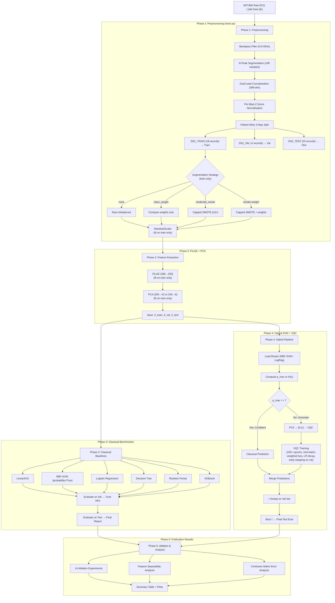

# Restructure Hybrid PILAE-VQC Pipeline for Publishable 5-Class Arrhythmia Results

The current revised pipeline produces 45.99% accuracy due to five compounding failures: SMOTE hallucination (4→45,402 for class Q), SMOTE applied before feature extraction, a confidently-wrong LinearSVC router, a starved/undertrained VQC, and double PCA on non-representative subsets. This plan restructures the **entire** pipeline from preprocessing through final evaluation, adds a validation set, implements a proper ablation study, and produces publication-grade metrics.

## User Review Required

> [!IMPORTANT]
> **Scope**: This plan modifies or replaces **every Python file** in the project except [noise_removal.py](file:///home/owl/math-sem4/arrythmia_hybrid_revised/src/backend/preprocessing/noise_removal.py), [feature_extraction.py](file:///home/owl/math-sem4/arrythmia_hybrid_revised/src/backend/preprocessing/feature_extraction.py), [normalisation.py](file:///home/owl/math-sem4/arrythmia_hybrid_revised/src/backend/preprocessing/normalisation.py), and [pilae_model.py](file:///home/owl/math-sem4/arrythmia_hybrid_revised/src/backend/pilae/pilae_model.py). These four files are architecturally sound and are preserved as-is.

> [!WARNING]
> **The existing `processed_data/` and `extracted_features/` .npy files are all trained on SMOTE-poisoned data.** After approval, the very first step is to re-run the entire preprocessing and feature extraction pipeline from scratch to produce clean outputs. All old .npy files will be replaced.

> [!IMPORTANT]
> **No backward compatibility with old experiments.** The new pipeline produces a 3-way split (train/val/test) instead of the old 2-way split, changes the data augmentation strategy, and restructures the classification scripts. Old log files will remain untouched in their directories for historical reference.

## Open Questions

> [!IMPORTANT]
> **Q1: What to do with Class Q (Unknown)?**
> Your DS1 training set has only **4 real Q-class samples**. Even moderate SMOTE (e.g. 5× oversampling) would produce only 20 synthetic samples from 4 seed points — still statistically unreliable. Three options:
> - **(A)** Keep Q as a class but rely entirely on `class_weight='balanced'` (no SMOTE for Q). SMOTE other minority classes moderately.
> - **(B)** Merge Q into a catch-all "Other" class with F, making it a 4-class problem (N, S, V, Other).
> - **(C)** Drop Q entirely and make it a 4-class problem (N, S, V, F), noting this in the paper.
>
> **My recommendation**: Option **(A)** — keep the full 5-class AAMI standard for publication integrity, handle Q purely with class weighting, and discuss the Q limitation explicitly in the paper's limitations section. This is the most honest and defensible approach.

> [!IMPORTANT]
> **Q2: Validation split strategy**
> The current De Chazal inter-patient split uses DS1 (22 records) for training and DS2 (23 records) for testing. We need a validation set. Two options:
> - **(A)** Hold out 4-5 records from DS1 as a validation set (e.g., records 201, 207, 209, 223 — chosen for class diversity).
> - **(B)** Use stratified k-fold cross-validation within DS1 for hyperparameter tuning, keep DS2 as the final untouched test set.
>
> **My recommendation**: Option **(A)** — a fixed held-out validation set from DS1. It's simpler, prevents any risk of k-fold leakage from the same patient, and the pipeline is already patient-wise. We'll select ~4 records from DS1 that contribute minority classes, carve them out as validation, and never touch DS2 until the single final evaluation.

> [!IMPORTANT]
> **Q3: Number of VQC qubits**
> The current pipeline uses 8 qubits (requiring a secondary PCA from 42→8). Options:
> - **(A)** 4 qubits — matches the baseline, very fast simulation, but may lose too much information for 5-class.
> - **(B)** 8 qubits — current choice, slower simulation, richer Hilbert space.
> - **(C)** Run the ablation with both 4 and 8, report the better one.
>
> **My recommendation**: Option **(C)** — include both in the ablation table. The computational cost section will justify whichever we pick.

---

## Proposed Changes

The restructuring is organized into 5 phases, matching the execution order. Each phase must complete before the next begins.

---

### Phase 1: Preprocessing — Clean Data Foundation

The core beat extraction, filtering, and per-beat normalisation are sound. We restructure the **splitting**, **augmentation**, and **scaling** stages.

#### [MODIFY] [config.py](file:///home/owl/math-sem4/arrythmia_hybrid_revised/src/backend/preprocessing/config.py)

- Add a `DS1_VAL` list: hold out records `['201', '207', '209', '223']` from `DS1_TRAIN` to create a validation set. These 4 records were chosen because they contain minority-class beats (V, F, S).
- Rename `DS1_TRAIN` to `DS1_TRAIN_FULL` for clarity, add `DS1_TRAIN` (the 18 remaining records) and `DS1_VAL` (the 4 held-out records).
- Add `OUTPUT_DIR` as an absolute path using `BASE_DIR` to avoid the current relative-path issue where `processed_data/` ends up wherever `main.py` is run from.

#### [MODIFY] [data_split.py](file:///home/owl/math-sem4/arrythmia_hybrid_revised/src/backend/preprocessing/data_split.py)

- Produce a 3-way split: `X_train, X_val, X_test` and `y_train, y_val, y_test`.
- Route records in `DS1_TRAIN` → train, `DS1_VAL` → val, `DS2_TEST` → test.
- **Log the raw class distribution** for each split before any augmentation, e.g.:
  ```
  Train class distribution (raw): {0: 38421, 1: 710, 2: 3102, 3: 312, 4: 3}
  Val class distribution (raw):   {0: 6981, 1: 212, 2: 536, 3: 84, 4: 1}
  Test class distribution (raw):  {0: 43896, 1: 1813, 2: 3091, 3: 386, 4: 2055}
  ```
  (Exact numbers will differ; these are illustrative.)

#### [MODIFY] [data_augmentation.py](file:///home/owl/math-sem4/arrythmia_hybrid_revised/src/backend/preprocessing/data_augmentation.py)

Complete rewrite of the augmentation strategy:

- **Accept a `strategy` parameter**: `'none'`, `'class_weight'`, `'moderate_smote'`, `'smote_plus_weight'`.
- **`'none'`**: Return data unchanged. For ablation baseline.
- **`'class_weight'`**: Return data unchanged but compute and return a weight vector. No synthetic samples generated.
- **`'moderate_smote'`**: 
  - Cap oversampling: each minority class is oversampled to at most `min(majority_count * 0.3, minority_count * 5)`. This means the biggest minority class grows to ~30% of Normal, and no class is inflated more than 5× its real size.
  - If a class has fewer than 10 real samples, skip SMOTE for that class — use `RandomOverSampler` with a modest cap (e.g., 50 samples max).
  - Dynamically set `k_neighbors = min(5, min_class_size - 1)`.
- **`'smote_plus_weight'`**: Apply moderate SMOTE as above, then also return class weights for the remaining imbalance.
- Remove the post-SMOTE Gaussian noise injection and signal shifting (these are corrupting the clean morphological features — they belong as a VQC-level training augmentation if needed, not at the data level).
- **Log** before/after class counts and the SMOTE strategy used.

#### [MODIFY] [global_scaling.py](file:///home/owl/math-sem4/arrythmia_hybrid_revised/src/backend/preprocessing/global_scaling.py)

- Accept 3 arrays: `X_train, X_val, X_test`.
- Fit `StandardScaler` on `X_train` only.
- Transform all three with the same fitted scaler.
- **Save** the fitted scaler to disk (`joblib.dump`) for reproducibility.

#### [MODIFY] [main.py](file:///home/owl/math-sem4/arrythmia_hybrid_revised/src/backend/preprocessing/main.py)

- Accept a command-line argument `--augmentation` with values `{none, class_weight, moderate_smote, smote_plus_weight}`.
- Call `data_split.py` → get 3-way split.
- **Log the raw class distribution** for all three splits.
- Call `data_augmentation.py` with the selected strategy on `X_train, y_train` **only**. Val and test are never touched.
- Call `global_scaling.py` with train/val/test.
- Export: `X_train.npy, X_val.npy, X_test.npy, y_train.npy, y_val.npy, y_test.npy`.
- If class weights are computed, export `class_weights.npy`.
- **Log** the final shape and class counts for each split.

**Files preserved unchanged:**
- [noise_removal.py](file:///home/owl/math-sem4/arrythmia_hybrid_revised/src/backend/preprocessing/noise_removal.py) ✅
- [feature_extraction.py](file:///home/owl/math-sem4/arrythmia_hybrid_revised/src/backend/preprocessing/feature_extraction.py) ✅
- [normalisation.py](file:///home/owl/math-sem4/arrythmia_hybrid_revised/src/backend/preprocessing/normalisation.py) ✅

---

### Phase 2: PILAE + PCA Feature Extraction — Leakage-Free

#### [MODIFY] [feature_pipeline.py](file:///home/owl/math-sem4/arrythmia_hybrid_revised/src/backend/pilae/feature_pipeline.py)

- Load 3-way split: `X_train, X_val, X_test`.
- **Fit PILAE on `X_train` only**. Transform all three.
- **Fit PCA on `Z_train` only** (the PILAE-transformed training set). Transform all three.
- Accept a `--pca_components` argument: either a float (e.g. `0.95` for variance retention) or an integer (e.g. `8` for fixed dimensionality). Default: `0.95`.
- Save: `Z_train_reduced.npy, Z_val_reduced.npy, Z_test_reduced.npy, y_train.npy, y_val.npy, y_test.npy`.
- **Save** the fitted PILAE encoder weights and PCA model to disk for reproducibility.
- **Log** dimensionality at each stage and the explained variance ratio.

#### [MODIFY] [pca_dim_reduction.py](file:///home/owl/math-sem4/arrythmia_hybrid_revised/src/backend/pilae/pca_dim_reduction.py)

- Accept 3 arrays: `Z_train, Z_val, Z_test`.
- Fit PCA on `Z_train` only. Transform all three.
- Return all three plus the fitted PCA model.

**File preserved unchanged:**
- [pilae_model.py](file:///home/owl/math-sem4/arrythmia_hybrid_revised/src/backend/pilae/pilae_model.py) ✅

---

### Phase 3: Classical Baselines — Comprehensive Benchmarking

#### [MODIFY] [train_classical.py](file:///home/owl/math-sem4/arrythmia_hybrid_revised/src/backend/classification/classical/train_classical.py)

Major restructuring:

- **Load 3-way features**: `Z_train, Z_val, Z_test` and corresponding labels.
- **Load class weights** if available (`class_weights.npy`).
- **Models to benchmark** (all with `class_weight='balanced'` where supported):

| Model | Key Parameters |
|---|---|
| Linear SVM | `LinearSVC(class_weight='balanced', dual=False, max_iter=10000)` |
| **RBF SVM** | `SVC(kernel='rbf', probability=True, class_weight='balanced')` ← **NEW** |
| Logistic Regression | `LogisticRegression(class_weight='balanced', max_iter=1000)` |
| Decision Tree | `DecisionTreeClassifier(class_weight='balanced')` |
| Random Forest | `RandomForestClassifier(class_weight='balanced', n_estimators=200)` |
| XGBoost | `XGBClassifier(scale_pos_weight=computed, eval_metric='mlogloss')` |

- **Evaluate on validation set** for hyperparameter selection.
- **Evaluate on test set** for final reporting (single pass, no tuning).
- **Metrics for every model** (computed via a shared `evaluate_model()` function):
  - Overall Accuracy
  - Macro-F1
  - Weighted F1
  - Balanced Accuracy (`sklearn.metrics.balanced_accuracy_score`)
  - Matthews Correlation Coefficient (`sklearn.metrics.matthews_corrcoef`)
  - Per-class Precision, Recall, F1
  - Confusion matrix + heatmap
- **Computational cost logging**:
  - Training time (`time.perf_counter()` around `.fit()`)
  - Inference time (around `.predict()` on test)
  - Number of parameters/trees where applicable
- **Save all models** to `saved_models/` via `joblib.dump`.
- **Fix the duplicate `evaluate_model` function** (current file defines it twice at lines 65 and 81).

---

### Phase 4: Hybrid SVM + VQC — The Core Contribution

#### [MODIFY] [quantum_model.py](file:///home/owl/math-sem4/arrythmia_hybrid_revised/src/backend/classification/vqc/quantum_model.py)

- Keep the `VQC` class structure but add:
  - A `MinMaxScaler` step inside `forward()` or as a pre-processing hook to scale inputs to $[0, \pi]$ before `AngleEmbedding`.
  - Support for configurable `n_qubits` and `n_layers` (already exists, just confirming).

#### [MODIFY] [train_hybrid.py](file:///home/owl/math-sem4/arrythmia_hybrid_revised/src/backend/classification/vqc/train_hybrid.py)

Complete rewrite. This becomes the core experimental script. Key changes:

**A. Routing Mechanism — Replace LinearSVC with Calibrated Probability Router**

```python
# Option 1: RBF SVM with predict_proba (recommended)
router = joblib.load('rbf_svm.pkl')
proba = router.predict_proba(X)
p_max = np.max(proba, axis=1)
ambiguous_mask = p_max <= TAU  # TAU is a probability in [0, 1]

# Option 2: Predictive entropy routing (alternative)
entropy = -np.sum(proba * np.log(proba + 1e-10), axis=1)
max_entropy = np.log(n_classes)
normalized_entropy = entropy / max_entropy
ambiguous_mask = normalized_entropy >= TAU_ENTROPY
```

**B. τ Tuning on Validation Set**

- Sweep `TAU` over `[0.50, 0.60, 0.70, 0.80, 0.85, 0.90, 0.95]`.
- For each τ, compute on the **validation set**:
  - Routing ratio (% classical vs % VQC)
  - Macro-F1
  - Balanced accuracy
  - Per-class F1 (especially S, F, Q)
  - Overall accuracy
- Select the τ that maximizes **Macro-F1** on validation.
- **Never use test data for τ selection.**
- Log the full τ sweep results as a table.

**C. VQC Training — Fix the Starvation**

- **PCA for VQC**: Fit a secondary PCA on the **full training set** (not just the ambiguous subset) to reduce from 42-dim → `n_qubits` dim. Save this PCA.
- **Feature scaling**: Apply `MinMaxScaler(feature_range=(0, np.pi))` to the PCA-reduced features, fit on training data only.
- **Weighted CrossEntropyLoss**: Compute class weights from the ambiguous training subset's label distribution.
- **Mini-batch training**: Use `DataLoader` with `batch_size=32, shuffle=True`.
- **Epochs**: 100 minimum (with early stopping on validation loss, patience=15).
- **LR schedule**: `CosineAnnealingLR` starting at 0.01, decaying to 1e-4.
- **Early stopping**: Monitor VQC loss on the ambiguous portion of the **validation set**.

**D. Comprehensive Logging**

For every experiment, log:
```
--- HYBRID EXPERIMENT SUMMARY ---
Router Model:            RBF-SVM
Threshold (τ):           0.80
Train: Total=X, Classical=Y, VQC=Z (%)
Val:   Total=X, Classical=Y, VQC=Z (%)
Test:  Total=X, Classical=Y, VQC=Z (%)
Classical-only accuracy:  XX.XX%
VQC-only accuracy:        XX.XX%
Hybrid accuracy:          XX.XX%
Macro-F1:                 X.XXXX
Balanced Accuracy:        X.XXXX
MCC:                      X.XXXX
Per-class F1: N=X.XX S=X.XX V=X.XX F=X.XX Q=X.XX
VQC Training Epochs:      XX
VQC Final Loss:           X.XXXX
Training Time:            XXs
Inference Time:           XXs
```

**E. Evaluation — Confusion Matrix Analysis**

- Generate confusion matrix heatmaps.
- **Explicitly log dominant error transitions**: N→S, N→F, S→N, Q→V.
- Compute and log the Q→V misclassification count and percentage.

#### [DELETE] [vqc_model.py](file:///home/owl/math-sem4/arrythmia_hybrid_revised/src/backend/classification/vqc/vqc_model.py)

This file is a near-duplicate of `train_hybrid.py` with an older version of the pipeline. Remove it to avoid confusion.

---

### Phase 5: Ablation Study — The Publication Framework

#### [NEW] [run_ablation.py](file:///home/owl/math-sem4/arrythmia_hybrid_revised/src/backend/classification/run_ablation.py)

A master script that orchestrates all ablation experiments. It calls the preprocessing, feature extraction, and classification pipelines with different configurations and collects results into a single summary table.

**Ablation experiments (minimum set):**

| # | Experiment | Description |
|---|---|---|
| 1 | `no_smote` | Raw imbalanced data, no class weighting |
| 2 | `class_weight` | Raw imbalanced data + `class_weight='balanced'` |
| 3 | `moderate_smote` | Moderate SMOTE (capped, no extreme inflation) |
| 4 | `smote_plus_weight` | Moderate SMOTE + class weighting |
| 5 | `classical_only_best` | Best classical model (RF or XGBoost) on winning augmentation |
| 6 | `vqc_only` | VQC alone, no classical router (all data → VQC via PCA) |
| 7 | `hybrid_linear_svm` | LinearSVC router (for comparison — shows why it fails) |
| 8 | `hybrid_rbf_svm` | RBF-SVM with `predict_proba` router |
| 9 | `hybrid_logreg` | Logistic Regression `predict_proba` router |
| 10 | `hybrid_entropy` | Predictive entropy routing |
| 11 | `tau_sweep` | Best router × τ ∈ {0.50, 0.60, 0.70, 0.80, 0.85, 0.90, 0.95} |
| 12 | `qubits_4_vs_8` | VQC with 4 qubits vs 8 qubits |
| 13 | `rbf_svm_vs_vqc` | RBF-SVM alone vs VQC alone (same reduced features) |
| 14 | `hybrid_vs_rbf_alone` | Best hybrid vs best RBF-SVM standalone |

**Output**: A summary CSV and a formatted markdown results table with all metrics (Accuracy, Macro-F1, Balanced Accuracy, MCC, per-class F1, training time, inference time).

#### [NEW] [feature_analysis.py](file:///home/owl/math-sem4/arrythmia_hybrid_revised/src/backend/classification/feature_analysis.py)

A diagnostic script to investigate feature-space separability:

- Load the clean (non-SMOTE) PILAE+PCA features.
- Compute pairwise class overlap using:
  - t-SNE 2D visualization colored by class.
  - Inter-class Mahalanobis distance matrix.
  - Fisher's Linear Discriminant ratio for each pair (N-S, S-V, V-F, V-Q, N-F).
- **Specifically investigate Q→V confusion**: Plot Q and V class distributions in the top-2 PCA components, compute overlap statistics.
- Save plots to `evaluation_plots/`.

---

## Summary of All File Changes

| File | Action | Phase |
|---|---|---|
| [config.py](file:///home/owl/math-sem4/arrythmia_hybrid_revised/src/backend/preprocessing/config.py) | MODIFY — add val split, fix paths | 1 |
| [data_split.py](file:///home/owl/math-sem4/arrythmia_hybrid_revised/src/backend/preprocessing/data_split.py) | MODIFY — 3-way patient-wise split | 1 |
| [data_augmentation.py](file:///home/owl/math-sem4/arrythmia_hybrid_revised/src/backend/preprocessing/data_augmentation.py) | MODIFY — multi-strategy, capped SMOTE | 1 |
| [global_scaling.py](file:///home/owl/math-sem4/arrythmia_hybrid_revised/src/backend/preprocessing/global_scaling.py) | MODIFY — 3-way scaling, save scaler | 1 |
| [main.py](file:///home/owl/math-sem4/arrythmia_hybrid_revised/src/backend/preprocessing/main.py) | MODIFY — CLI args, 3-way pipeline | 1 |
| [noise_removal.py](file:///home/owl/math-sem4/arrythmia_hybrid_revised/src/backend/preprocessing/noise_removal.py) | ✅ UNCHANGED | — |
| [feature_extraction.py](file:///home/owl/math-sem4/arrythmia_hybrid_revised/src/backend/preprocessing/feature_extraction.py) | ✅ UNCHANGED | — |
| [normalisation.py](file:///home/owl/math-sem4/arrythmia_hybrid_revised/src/backend/preprocessing/normalisation.py) | ✅ UNCHANGED | — |
| [pca_dim_reduction.py](file:///home/owl/math-sem4/arrythmia_hybrid_revised/src/backend/pilae/pca_dim_reduction.py) | MODIFY — 3-way transform | 2 |
| [feature_pipeline.py](file:///home/owl/math-sem4/arrythmia_hybrid_revised/src/backend/pilae/feature_pipeline.py) | MODIFY — 3-way, save models, CLI args | 2 |
| [pilae_model.py](file:///home/owl/math-sem4/arrythmia_hybrid_revised/src/backend/pilae/pilae_model.py) | ✅ UNCHANGED | — |
| [train_classical.py](file:///home/owl/math-sem4/arrythmia_hybrid_revised/src/backend/classification/classical/train_classical.py) | MODIFY — add RBF-SVM, metrics, timing, fix duplicate fn | 3 |
| [quantum_model.py](file:///home/owl/math-sem4/arrythmia_hybrid_revised/src/backend/classification/vqc/quantum_model.py) | MODIFY — add [0,π] scaling option | 4 |
| [train_hybrid.py](file:///home/owl/math-sem4/arrythmia_hybrid_revised/src/backend/classification/vqc/train_hybrid.py) | MODIFY — complete rewrite of routing, training, evaluation | 4 |
| [vqc_model.py](file:///home/owl/math-sem4/arrythmia_hybrid_revised/src/backend/classification/vqc/vqc_model.py) | DELETE — duplicate of train_hybrid.py | 4 |
| [run_ablation.py](file:///home/owl/math-sem4/arrythmia_hybrid_revised/src/backend/classification/run_ablation.py) | NEW — master ablation orchestrator | 5 |
| [feature_analysis.py](file:///home/owl/math-sem4/arrythmia_hybrid_revised/src/backend/classification/feature_analysis.py) | NEW — feature separability diagnostics | 5 |

---

## Execution Flow Diagram



---

## Verification Plan

### Automated Tests

**Phase 1 — Data Integrity Checks**
```bash
# After preprocessing, verify no data leakage
python -c "
import numpy as np
X_train = np.load('processed_data/X_train.npy')
X_val = np.load('processed_data/X_val.npy')
X_test = np.load('processed_data/X_test.npy')
print(f'Train: {X_train.shape}, Val: {X_val.shape}, Test: {X_test.shape}')
# Verify no overlap
assert X_train.shape[0] + X_val.shape[0] != 227010, 'Old SMOTE data still present!'
print('✓ No SMOTE inflation detected')
"
```

**Phase 2 — Feature Extraction Sanity**
```bash
python -c "
import numpy as np
Z_train = np.load('src/backend/pilae/extracted_features/Z_train_reduced.npy')
Z_val = np.load('src/backend/pilae/extracted_features/Z_val_reduced.npy')
Z_test = np.load('src/backend/pilae/extracted_features/Z_test_reduced.npy')
print(f'Feature dims: train={Z_train.shape}, val={Z_val.shape}, test={Z_test.shape}')
assert Z_train.shape[1] == Z_val.shape[1] == Z_test.shape[1], 'Dimension mismatch!'
print('✓ All splits have consistent dimensions')
"
```

**Phase 3 — Classical Baselines**
```bash
cd src/backend/classification/classical
python train_classical.py
# Verify: All 6 models trained, metrics logged, models saved
# Verify: RBF-SVM accuracy > LinearSVC accuracy on val set
# Verify: class_weight='balanced' improves minority F1
```

**Phase 4 — Hybrid Pipeline**
```bash
cd src/backend/classification/vqc
python train_hybrid.py --router rbf_svm --tau 0.80
# Verify: VQC receives >10% of test samples
# Verify: VQC loss < 1.2 after training (not ~1.6 random guess)
# Verify: Hybrid accuracy > classical-only accuracy
```

**Phase 5 — Ablation**
```bash
cd src/backend/classification
python run_ablation.py
# Verify: All 14 experiments complete
# Verify: Summary CSV generated with all metrics
```

### Manual Verification

- Review the Q→V confusion count in the hybrid confusion matrix — it should be significantly lower than the current 1,697.
- Visually inspect the t-SNE plot from `feature_analysis.py` — Q and V clusters should be discussed in the paper.
- Verify that the τ sweep table shows a clear optimum (not monotonic).
- Confirm training times are reasonable (VQC should complete in <30 mins on CUDA, <2hrs on CPU).
